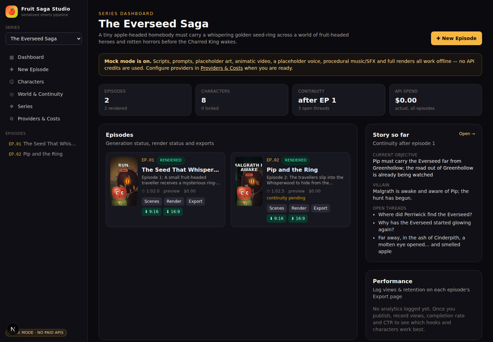
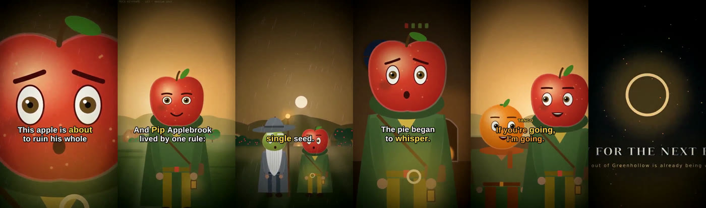
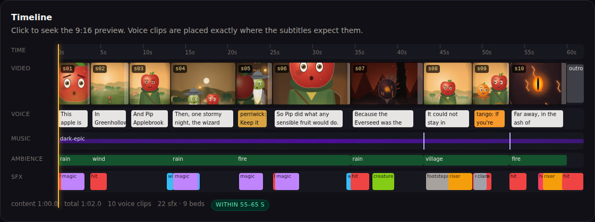
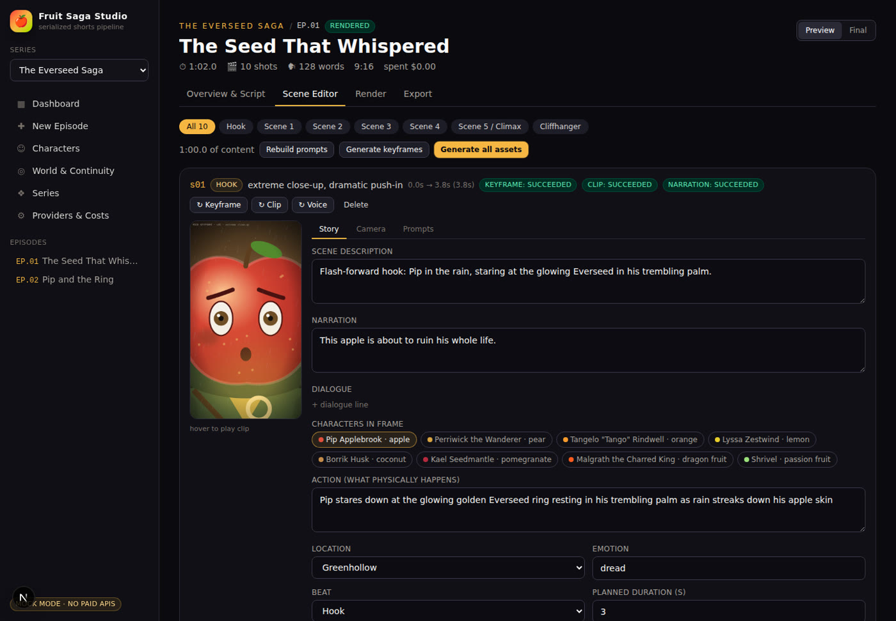

# 🍎 Fruit Saga Studio

A local-first production studio for a **serialized, fruit-headed epic fantasy parody** on YouTube Shorts, TikTok and Instagram Reels.

You type a one-line synopsis → the studio writes a ~60 s screenplay that respects the series continuity, breaks it into 6–10 shots with varied cinematography, composes image/video prompts that **always inject the character bible**, generates keyframes, clips, voices, music, SFX and subtitles, mixes to **-14 LUFS**, and assembles **1080×1920 (9:16)** and **1920×1080 (16:9)** videos — plus titles, captions, hashtags and thumbnails. You can review and edit every scene before anything costly is generated.

**Mock mode (on by default) runs the entire pipeline offline without buying API credits**: an offline story writer, procedural placeholder art of the actual characters, an animatic renderer that applies each shot's camera move, a placeholder voice timed like real narration, and procedural original music and sound effects.



| Mock keyframes → rendered frames with word-highlight captions | Render timeline |
| --- | --- |
|  |  |

---

## Contents

1. [Quick start](#quick-start)
2. [Installing FFmpeg](#installing-ffmpeg)
3. [The workflow](#the-workflow)
4. [Environment variables](#environment-variables)
5. [Providers](#providers)
6. [The pipeline](#the-pipeline)
7. [Characters (consistency system)](#characters--the-consistency-system)
8. [Episodes & scenes](#creating-episodes)
9. [Continuity](#continuity)
10. [Rendering](#rendering-videos)
11. [Cost control, cache & retries](#cost-control-cache--retries)
12. [Metadata, thumbnails, export & analytics](#social-metadata-thumbnails-export--analytics)
13. [Project structure](#project-structure)
14. [Adding a new AI provider](#adding-a-new-ai-provider)
15. [Prompt templates](#prompt-templates)
16. [CLI scripts & tests](#cli-scripts--tests)
17. [Troubleshooting](#troubleshooting)
18. [Creative & copyright guidelines](#creative--copyright-guidelines)

---

## Quick start

Requirements: **Node.js ≥ 20.9** and **FFmpeg ≥ 6** (with libx264 + libass — standard builds have both).

```bash
cd fruit-saga-studio
npm install
npm run dev
```

Open <http://localhost:3000>. On first start the SQLite database is created, migrated and seeded with the demo series **The Everseed Saga**:

* 8 original fruit-headed characters (6 heroes, 1 dark lord, 1 corrupted creature)
* 6 environments
* a fully written demo **Episode 1**, ready to render

No `.env` is needed for the demo. To try the whole workflow from the terminal:

```bash
npm run check   # verifies FFmpeg, storage, providers
npm run demo    # renders EP1, commits it to continuity, writes + renders EP2 from a synopsis
```

The videos land in `output/everseed-saga/episode_001/preview_vertical.mp4` and `…/preview_youtube.mp4`. Use `npm run demo -- --mode final` to get 1080p output.

## Installing FFmpeg

| OS | Command |
| --- | --- |
| macOS | `brew install ffmpeg` |
| Ubuntu / Debian | `sudo apt install ffmpeg` |
| Fedora | `sudo dnf install ffmpeg` (RPM Fusion) |
| Windows | `winget install Gyan.FFmpeg` or `choco install ffmpeg` |

If `ffmpeg` is not on your `PATH`, set `FFMPEG_PATH` / `FFPROBE_PATH` in `.env`. `npm run check` verifies that the required filters exist (`zoompan`, `xfade`, `sidechaincompress`, `loudnorm`, `ass`, `aevalsrc`, `amix`, `gblur`).

## The workflow

1. Open the app and pick a series in the sidebar (or create one under **Series**).
2. Click **New Episode**.
3. Enter a synopsis, e.g. *“Episode 1: A small fruit-headed traveller receives a mysterious ring-shaped magical object and learns that it must be taken far from home.”* Choose the tone, target duration (55–65 s), platform and quality.
4. Click **Create & Generate**. The studio produces the **script, narration audio, shot list, image prompts, video prompts, subtitle files and sound plan** (no images or video yet, so this step is cheap).
5. Review and edit everything:
   * **Overview & Script** — the hook, the five scenes, the cliffhanger and the tease.
   * **Scene Editor** — every field of every shot: narration, dialogue, cast, location, framing, movement, lighting, and the prompts.
6. Check the **cost estimate** (per scene and per episode; cached assets are free).
7. Click **Render Episode**. It generates any missing keyframes, clips, voices and thumbnails, then mixes and assembles the video.
8. Go to **Export** and download or package the video for TikTok, YouTube Shorts, Instagram Reels and YouTube 16:9, with ready-to-paste captions.
9. Click **Commit to continuity** so the next episode knows what happened. The studio does this automatically when you write the next episode.

The five stage buttons (**Generate Script → Generate Shot List → Generate Prompts → Generate Assets → Render Episode**) let you run the pipeline one step at a time. Toggle **Preview / Final** at the top of each episode.



## Environment variables

Copy `.env.example` to `.env`. Each variable is documented there; these are the ones that matter most:

| Variable | Default | Purpose |
| --- | --- | --- |
| `MOCK_MODE` | `true` | `true` never calls a paid API; the full pipeline still works. |
| `DEFAULT_RENDER_MODE` | `preview` | Quality of new episodes. |
| `LLM_PROVIDER`, `IMAGE_PROVIDER`, `VIDEO_PROVIDER`, `TTS_PROVIDER` | openai / openai / runway / openai | Providers used when mock mode is off. |
| `PREVIEW_VIDEO_PROVIDER` | `mock` | The free animatic for previews, so previews never pay for video. |
| `MAX_EPISODE_BUDGET_USD` | `5` | A run whose uncached estimate exceeds this asks for confirmation first. |
| `IMAGE_QUALITY_PREVIEW` / `_FINAL` | `low` / `high` | Image quality per mode. |
| `RETRY_MAX_ATTEMPTS`, `RETRY_BASE_DELAY_MS` | `4`, `2000` | Exponential backoff for provider calls. |
| `GENERATION_CONCURRENCY` | `2` | Parallel keyframe/clip generations. |
| `DATA_DIR`, `OUTPUT_DIR`, `CACHE_DIR`, `DATABASE_PATH` | `./data`, `./output`, `./cache` | Storage locations. |
| `SUBTITLE_FONT` | `Arial` | Font for burned-in captions. |
| API keys | — | `OPENAI_API_KEY`, `ANTHROPIC_API_KEY`, `STABILITY_API_KEY`, `RUNWAY_API_KEY`, `LUMA_API_KEY`, `KLING_ACCESS_KEY`/`KLING_SECRET_KEY`, `GEMINI_API_KEY`, `ELEVENLABS_API_KEY` |

API keys are only ever read on the server; the Settings page shows whether a key is present, never its value.

## Providers

| Capability | Providers | Notes |
| --- | --- | --- |
| **LLM** (story, shot list, metadata, continuity) | `mock`, `openai` (Chat Completions, JSON mode — works with OpenAI-compatible servers via `OPENAI_BASE_URL`), `anthropic` (Messages API), `ollama` (free, local) | Output is validated against zod schemas; one automatic repair round if the JSON is invalid. |
| **Image** (keyframes, thumbnails, reference sheets) | `mock`, `openai` (gpt-image-1; sends character **reference images** through the edits endpoint), `stability` (negative prompt + seed) | Results are cropped to the exact frame using attention-based cropping. |
| **Video** (image-to-video) | `mock` (animatic), `runway`, `luma`, `kling`, `veo` (Gemini API) | Requests are rounded up to the provider's supported clip lengths; clips are slowed down or held to fit the shot. |
| **TTS** | `mock`, `openai` (voice direction via `instructions`), `elevenlabs` (**exact word timestamps**), `local` (`say`, espeak-ng, piper) | `TTSProvider.generate(text, voiceConfig, options)` |

Provider selection order:
1. `MOCK_MODE=true`, or **Force mock mode** on the Settings page, always wins.
2. **Providers & Costs** (Settings page), saved per capability and per mode (preview/final), including model, quality and your own prices.
3. The environment variables.

> ⚠️ The real-provider adapters (Runway, Luma, Kling, Veo, ElevenLabs, Stability, OpenAI, Anthropic, Ollama) are written against each provider's public API documentation. They were **not exercised with live keys** during development, and provider APIs change. Before a full final render, run one preview episode (or one scene) with a new provider. Each adapter is a single small file in `lib/ai/providers/` if something needs adjusting.

## The pipeline

| # | Stage | What it does | Output |
| --- | --- | --- | --- |
| 1 | **Story** | Writes a ~60 s screenplay (hook 0–3 s, five scenes, cliffhanger 53–60 s) from the synopsis, the character bible, the **continuity state** and the previous episodes. Word budget ≈ 0.8–0.93 × duration × WPM (≈ 120–140 words at 150 wpm). | episode beats, hook, cliffhanger, tease |
| 2 | **Shot list** | 6–10 shots with duration, cast, action, framing, movement, environment, lighting, emotion and transition. Post-processing enforces camera variety (no identical framing or movement twice in a row) and makes durations add up. | scenes |
| 3 | **Image prompts** | `[character consistency block] + [action] + [environment] + [camera] + [lighting] + [rendering style]`, plus a negative prompt (global negatives and each character's negative traits). | `image_prompt`, `negative_prompt` |
| 4 | **Video prompts** | Explicit **subject motion, camera motion, environment motion, facial expression and shot duration**, including mouth movement when a character speaks. | `video_prompt` |
| 5 | **Voiceover** | One TTS call per spoken line (narrator and character voices). Shots grow if their lines need more room; slack from other shots is taken back so the episode stays on target. | `audio/narration.wav`, timeline |
| 6 | **Sound design** | Location ambience beds, weather beds, and SFX cues from each shot's notes and transitions (whoosh on whip pans, a hit on the hook, a riser into the cliffhanger), plus an original procedural score with swells. The music is ducked under the voice. | sound plan, `music.wav`, `sfx.wav` |
| 7 | **Subtitles** | Captions of at most two lines, SRT + ASS, large and outlined, placed above the TikTok/Reels UI, with optional **word-by-word highlighting** and speaker labels. | `subtitles/*.srt`, `*.ass` |
| 8 | **Assembly** | Normalises clips, applies xfade transitions or hard cuts exactly on the timeline, adds intro/outro cards, grain and vignette, burns in the captions, and muxes the mix. | `final_vertical.mp4`, `final_youtube.mp4` |

Social metadata, thumbnails and continuity run alongside these stages.

## Characters — the consistency system

The character bible (**Characters** page, saved to `data/series/<id>/characters.json`) stores for each character: `id, display_name, role, archetype, descriptor, fruit, fruit_description, face_description, body_description, costume, props, height, personality, visual_traits, negative_traits, voice_profile, voice, reference_images, palette, locked`.

* **Characters are never generated by name.** Every image, video and thumbnail prompt injects each on-screen character's full consistency block (`prompts/character_prompt.txt`). Names in action text, and in other characters' fields, are replaced by visual descriptors (“the small apple-headed traveller”). The test suite checks this for every prompt.
* **Lock appearance** freezes the exact block used in prompts. Appearance fields become read-only, and the API returns **423** if you try to change them.
* **Reference images**: upload them, or click **Generate reference sheet** to create one with the image provider. Providers that support visual references (OpenAI Images) receive them with every keyframe of that character.
* **Voices**: an OpenAI voice, an ElevenLabs voice id, a local voice, and a pitch for the mock voice. The free-text voice profile is sent as direction to TTS models that accept it.

**To create a character**: open Characters, click **New character**, fill in the fruit head, face, body, costume, props and never-changing traits. Save, generate a reference sheet, keep the best one, then lock the character.

## Creating episodes

Episodes live in SQLite. Each change is mirrored to `data/series/<series>/episodes/episode_NNN.json`, with the exact structure below (plus `beats`, `metadata`, `sound_plan` and `timeline`):

```jsonc
{ "episode_number": 1, "title": "", "summary": "", "hook": "", "narration": "", "scenes": [ /* … */ ],
  "cliffhanger": "", "next_episode_tease": "" }
// each scene:
{ "scene_id": "s01", "duration": 8, "description": "", "characters": [], "location": "", "camera": "",
  "action": "", "emotion": "", "narration": "", "sound_design": "", "image_prompt": "", "video_prompt": "", "negative_prompt": "" }
```

Editorial control:
* Every field is editable in the **Scene Editor**.
* Editing an image, video or negative prompt by hand **locks** it (🔒), so automatic regeneration keeps your text. Unlock it to let the engine rebuild it.
* **↻ Keyframe** gives a scene a new seed, so you get a new variation and a new cache entry. **↻ Clip** and **↻ Voice** regenerate only that asset.
* Scenes can be added, deleted and re-timed. The timeline reflows automatically.

## Continuity

`series_state.json` records, after each episode: major events, character locations, possessions, injuries, emotional states, relationships, the current objective, the villain's state, unresolved plot points, world facts and episode summaries.

* A **snapshot is stored per episode**. Writing episode N always reads the snapshot for episode N−1, never LLM memory, so regenerating an old episode never sees its own future.
* **Commit to continuity** (on the episode page) updates the state from the final script. If you start writing N+1 before committing N, the studio commits N first.
* **World & Continuity** lets you edit the state by hand at any time.

## Rendering videos

Open **Render** and click **Render episode**. Missing assets are generated first; everything unchanged comes from the cache, and an unchanged episode re-renders in under a second.

* **Preview**: 540×960 and 960×540, fast encodes, the free animatic video, low image quality, cheap TTS models.
* **Final**: 1080×1920 and 1920×1080 at 30 fps, high image quality, final TTS, two-pass `loudnorm` to **-14 LUFS integrated / -1.5 dBTP**, and a limiter so nothing clips.
* **9:16 ⇄ 16:9**: the other orientation is derived with a blurred fill (no crop) or a crop (series setting). Captions are laid out separately for each orientation.
* The Render tab shows a timeline (video, voice, music, ambience and SFX lanes), measured loudness and true peak, and download links for each stem, the subtitle files and `render.log`.

Output layout:

```
output/<series>/episode_001/
  keyframes/  clips/  thumbnails/  subtitles/  metadata/  exports/  render/
  audio/narration.wav  audio/music.wav  audio/sfx.wav  audio/mix.wav  audio/voice/*.wav
  final_vertical.mp4  final_youtube.mp4        (final mode)
  preview_vertical.mp4  preview_youtube.mp4    (preview mode)
  render.log
```

## Cost control, cache & retries

* **Estimates before generation**: per scene (image, video, voice) and per episode (plus LLM and thumbnails), for preview or final, with cached assets priced at $0. The prices in `lib/ai/pricing.ts` are rough defaults; set your real prices in Settings.
* **Budget guard**: a run whose uncached estimate exceeds `MAX_EPISODE_BUDGET_USD` returns HTTP 402, and the UI asks you to confirm.
* **Content-addressed cache** (`cache/`): the SHA-256 of provider + model + prompt + seed + size + quality + input-image hash + reference hashes. An identical request is never paid for twice. The Settings page shows cache reuse and the money it saved.
* **Retries**: exponential backoff with jitter. `Retry-After` is honoured; 4xx errors and missing keys fail fast.
* **Per-asset jobs**: every keyframe, clip, voice line and render step is its own `GenerationJob`. A failure affects only that asset. Use **Retry** on a job, or **Retry N failed**, and only the failed assets are regenerated.

## Social metadata, thumbnails, export & analytics

* **Metadata** per episode: a YouTube Shorts title (curiosity-driven, `| Series EP.NN`), a TikTok caption, an Instagram caption, a YouTube description, 5–10 hashtags, thumbnail text and concept, and a next-episode teaser. Everything is editable, and it is also written as ready-to-paste `.txt` files in `metadata/`.
* **Thumbnails**: 9:16 and 16:9 prompts (1–3 big fruit faces, clear conflict, dramatic light, space for text). The image is generated without text, and the studio overlays the title text and an episode badge so they stay crisp.
* **Export** writes `exports/<platform>/` with the video, `caption.txt` and thumbnail for TikTok, Shorts, Reels and YouTube 16:9.
* **Analytics**: log views, likes, comments, shares, saves, average watch time, completion rate, CTR, followers gained and a retention curve per platform. Export also records each episode's features (hook, title, cast, shot framings, locations, duration) in `episode_features`, and the dashboard ranks episodes by completion rate. This data is there so you can later analyse which hooks, characters, scene types, durations and titles perform best.

## Project structure

```
fruit-saga-studio/
├─ app/                      Next.js App Router (pages + API routes)
│  ├─ page.tsx               Dashboard
│  ├─ episodes/new           Episode Creator
│  ├─ episodes/[id]/…        Overview & Script · Scene Editor · Render · Export
│  ├─ characters, world, series, settings
│  └─ api/…                  REST API (series, characters, episodes, run, jobs, files …)
├─ components/               UI (episode workspace, character bible, settings …)
├─ lib/
│  ├─ ai/                    provider interfaces, registry, retry, cache, pricing, JSON repair
│  │  ├─ providers/{llm,image,video,tts}/   one file per provider
│  │  └─ mock/               offline writer, procedural fruit-character art
│  ├─ story/                 stages 1–2 + metadata + continuity engines
│  ├─ prompts/               template engine, prompt composer, cinematography vocabulary
│  ├─ audio/                 timing model, narration/timeline, sound design, synth, mix
│  ├─ video/                 ffmpeg runner, animatic motion, subtitles, assembly, thumbnails
│  ├─ pipeline/              job runner, request builders, estimates, export, paths
│  └─ db/                    SQLite connection + migrations runner + repositories
├─ db/migrations/            SQL migrations (applied automatically)
├─ prompts/                  editable prompt templates (*.txt)
├─ data/seed/                the demo series (read-only)
├─ data/series/<id>/         JSON mirror of your series (bible, locations, state, episodes)
├─ data/audio-library/       optional licensed music/SFX
├─ output/  cache/           renders and the generation cache (git-ignored)
└─ scripts/                  demo, render, seed, migrate, check, test
```

Database entities (SQLite, `db/migrations/`): **Series, Character, Location, Episode, Scene, Asset, GenerationJob, asset_cache, ProviderConfig, continuity_snapshots, episode_analytics, episode_features**. Rich documents (bible entries, scenes, scripts) are stored as validated JSON next to indexed columns.

## Adding a new AI provider

1. Create `lib/ai/providers/<kind>/<name>.ts` implementing the interface from `lib/ai/types.ts`:

   ```ts
   import type { VideoProvider, VideoRequest, VideoResult } from "@/lib/ai/types";
   import { fetchJson } from "@/lib/ai/http";            // classifies HTTP errors (429/5xx → retryable)
   import { MissingCredentialsError } from "@/lib/ai/retry";
   import { pollUntil, downloadToTemp, imageDataUri, roundUpDuration } from "@/lib/ai/providers/video/common";

   export class AcmeVideoProvider implements VideoProvider {
     readonly name = "acme";
     readonly durations = [5, 10];
     constructor(readonly model = "acme-v1", private pricing: Record<string, number> = {}) {}
     async generate(req: VideoRequest, onProgress?: (p: number) => void): Promise<VideoResult> {
       if (!process.env.ACME_API_KEY) throw new MissingCredentialsError("Acme", "ACME_API_KEY");
       // submit → pollUntil(...) → downloadToTemp(url)
       return { filePath, duration, cost: this.estimateCost(req), model: this.model };
     }
     estimateCost(req: Pick<VideoRequest, "duration">) { return roundUpDuration(req.duration, this.durations) * (this.pricing.per_second ?? 0); }
     cacheParts(req: VideoRequest, imageHash: string) { return { image: imageHash, prompt: req.prompt, d: req.duration }; } // everything that changes the output
   }
   ```
2. Register it in `lib/ai/registry.ts`: add an entry to `PROVIDER_CATALOG` and a `case` in `getVideoProvider()`.
3. Add default prices to `lib/ai/pricing.ts` and the env vars to `.env.example`.
4. Select it under **Providers & Costs** for preview and/or final.

Retries, caching, cost estimates, per-asset jobs and the UI work automatically. Throw `ProviderError(msg, { retryable })` for anything unusual.

## Prompt templates

All long prompts live in `prompts/` and reload on save, with no restart:

| File | Used for |
| --- | --- |
| `story_prompt.txt` | Stage 1 screenplay (system + user) |
| `shotlist_prompt.txt` | Stage 2 shot list |
| `character_prompt.txt` | the character consistency block |
| `image_prompt.txt` | keyframe prompt layout |
| `video_prompt.txt` | animation prompt layout |
| `continuity_prompt.txt` | updating the series state after an episode |
| `continuity_context.txt` | how the state is presented to the story engine |
| `metadata_prompt.txt` | titles, captions, hashtags, thumbnail concept |
| `thumbnail_prompt.txt` | 9:16 and 16:9 thumbnail prompts |
| `style_guide.txt` | the global rendering style (full + short) |
| `negative_prompt.txt` | global negatives |

Syntax: `{{variable}}`, `{{variable|fallback}}`, `{{#if variable}}…{{/if}}`. Lines starting with `##` are comments. `=== SYSTEM ===` / `=== USER ===` split chat prompts.

## CLI scripts & tests

| Command | What it does |
| --- | --- |
| `npm run dev` / `npm run build && npm start` | Runs the app |
| `npm run demo [-- --mode final] [-- --skip-new]` | End-to-end demo (see Quick start) |
| `npm run render -- --episode 2 [--mode final] [--action generate\|assets\|render\|all] [--stages keyframes,clips] [--scenes s03] [--force] [--estimate] [--yes]` | Runs any part of the pipeline from the terminal |
| `npm run check` | Checks FFmpeg, storage, providers and keys |
| `npm run db:migrate` | Applies pending SQL migrations |
| `npm run db:seed` | Seeds if the database is empty |
| `npm run db:reset` | Rebuilds the database from `data/series/` (your JSON mirror); `-- --demo` restores the pristine demo |
| `npm test` | 14 end-to-end tests in a temp directory (prompt injection, word budgets, camera variety, continuity, locks, full render + loudness, cache reuse, failure isolation, budget guard, export) |
| `npm run typecheck` | TypeScript check |

## Troubleshooting

* **“FFmpeg not found”**: install FFmpeg, or set `FFMPEG_PATH`, then run `npm run check`.
* **`better-sqlite3` fails to install**: it downloads a prebuilt binary; if that fails it compiles, which needs Python 3 and a C++ toolchain (Xcode CLT on macOS, `build-essential` on Linux, VS Build Tools on Windows).
* **Captions use a fallback font**: install the font named by `SUBTITLE_FONT`, or drop a `.ttf` into `assets/fonts/`.
* **A job keeps failing**: open the job's error on the episode page. Missing keys and 4xx errors are not retried. After fixing the cause, click **Retry**.
* **The server restarted mid-run**: interrupted jobs are marked failed at the next start. Click **Retry N failed**.
* **Starting fresh**: `npm run db:reset -- --demo` (renders and the cache are kept; delete `output/` and `cache/` to reclaim space).

## Creative & copyright guidelines

The seed series, characters, names, dialogue, designs, music and sound effects are all original. Prompts forbid actor likenesses, replica film costumes, movie-still recreations, fruit emojis, watermarks and on-image text, and the story prompt forbids quoting existing films or books. Keep your own synopses transformative: a parody or recap in an original visual language, not frame-for-frame recreations of existing films, and use only music you have the rights to (see `data/audio-library/README.md`).
